# LA BRASA VIVA

**Bitácora Corte 2 — Desarrollo y Operaciones de Software (DOSW)**
Escuela Colombiana de Ingeniería Julio Garavito
Autor: Julian Felipe Morales Zambrano

Proyecto base: [Laboratorio 3 — DOSW_LABORATORIO_3_CarlosCristianJulian](https://github.com/cristianmorenor/DOSW_LABORATORIO_3_CarlosCristianJulian)

---

## Descripción del restaurante

**LA BRASA VIVA** es un restaurante de parrilla. Esta API digitaliza el ciclo completo de una orden:
consulta de la carta con disponibilidad en tiempo real, armado y confirmación del pedido con el
término de cocción de cada corte, tablero de cocina, y cierre de la cuenta con su pago.

Hoy la operación se maneja con comandas en papel y llamados verbales a la cocina, lo que genera
cortes vendidos sin inventario, términos de cocción mal comunicados, cero visibilidad del estado
del pedido entre salón y cocina, y ningún dato de ventas para decidir.

El MVP valida el ciclo **carta → pedido → cocina → pago** antes de escalar a domicilios y reservas.

### Actores

| Rol | Qué hace |
|---|---|
| Cliente | Consulta la carta, arma su pedido, elige el término de cocción y sigue su preparación |
| Mesero | Toma y modifica órdenes, las envía a cocina y cierra la cuenta |
| Parrillero / Cocina | Opera el tablero de cocina, actualiza estados y marca ingredientes agotados |
| Administrador | Administra carta, inventario y usuarios, y consulta reportes de venta |

### Roles y permisos

También disponible en Excel: [`docs/roles-permisos.xlsx`](docs/roles-permisos.xlsx) (matriz y una hoja por rol).

| Funcionalidad | Cliente | Mesero | Parrillero / Cocina | Administrador |
|---|:-:|:-:|:-:|:-:|
| Ver el menú | ✅ | ✅ | ✅ | ✅ |
| Crear, editar y eliminar platos | ❌ | ❌ | ❌ | ✅ |
| Marcar un plato como agotado | ❌ | ❌ | ✅ | ✅ |
| Crear pedido / agregar ítems (solo en `RECIBIDO`) | ✅ | ✅ | ❌ | ❌ |
| Cancelar un pedido (solo en `RECIBIDO`) | ❌ | ✅ | ❌ | ✅ |
| Ver el estado de su pedido | ✅ | ✅ | ✅ | ✅ |
| Ver el tablero de cocina | ❌ | ✅ | ✅ | ✅ |
| Cambiar estado a `EN_PREPARACION` / `LISTO` | ❌ | ❌ | ✅ | ❌ |
| Cambiar estado a `ENTREGADO` | ❌ | ✅ | ❌ | ❌ |
| Abrir cuenta y registrar pago | ❌ | ✅ | ❌ | ❌ |
| Crear mesas | ❌ | ❌ | ❌ | ✅ |
| Ver mesas | ❌ | ✅ | ✅ | ✅ |
| Crear, modificar y cancelar reservas | ✅ | ✅ | ❌ | ✅ |
| Parqueadero (entrada y salida) | ❌ | ✅ | ❌ | ✅ |
| Ver reportes de venta | ❌ | ❌ | ❌ | ✅ |
| Administrar usuarios | ❌ | ❌ | ❌ | ✅ |

> La autenticación (JWT) y la autorización por rol ya están implementadas: ver la sección
> [Seguridad](#seguridad) para la matriz endpoint por endpoint.

### Reglas de negocio

| Código | Regla |
|---|---|
| RN-01 | Un pedido solo se modifica en estado `RECIBIDO` |
| RN-02 | Un plato no puede ordenarse si algún ingrediente está agotado |
| RN-03 | Una mesa tiene una sola cuenta abierta; se cierra al registrar el pago |
| RN-04 | El precio queda congelado al agregar el plato al pedido |
| RN-P01 | Todo corte debe registrar su término de cocción |
| RN-P02 | La parrilla admite máximo 8 cortes simultáneos; el resto queda en cola |
| RN-P03 | Un corte de más de 25 min no puede ordenarse en los últimos 30 min de servicio |

---

## Diagramas

### Diagrama de contexto (C4 — Nivel 1)

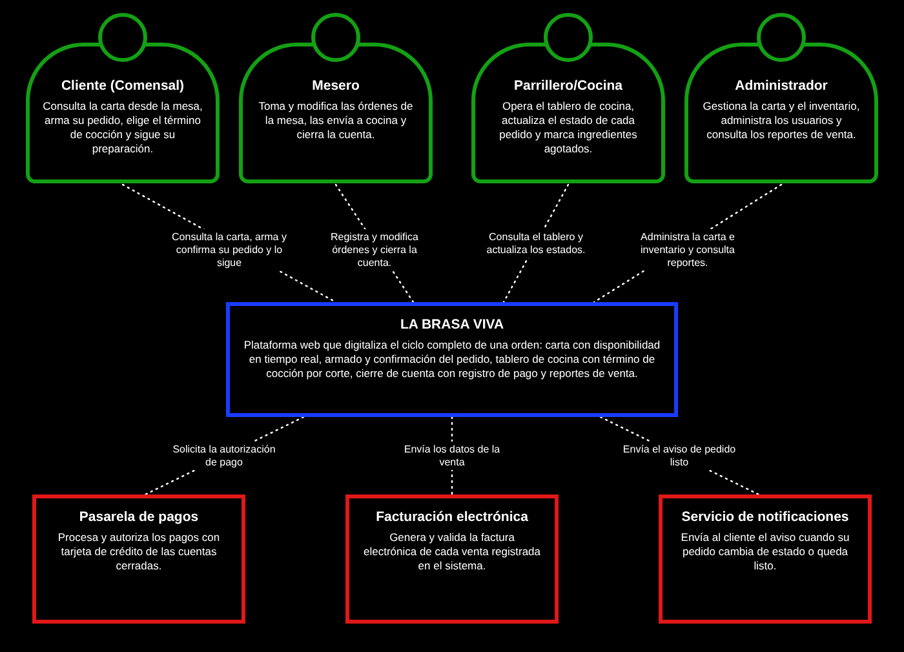

### Casos de uso

**RF-03 — Agregar ítem al pedido con término de cocción**

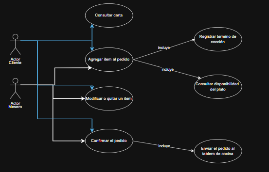

**RF-06 — Cambiar el estado de un pedido en el tablero de cocina**

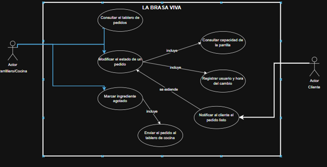

**RF-09 — Cerrar la cuenta y registrar el pago**

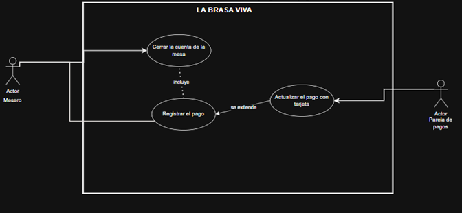

### Diagrama de clases

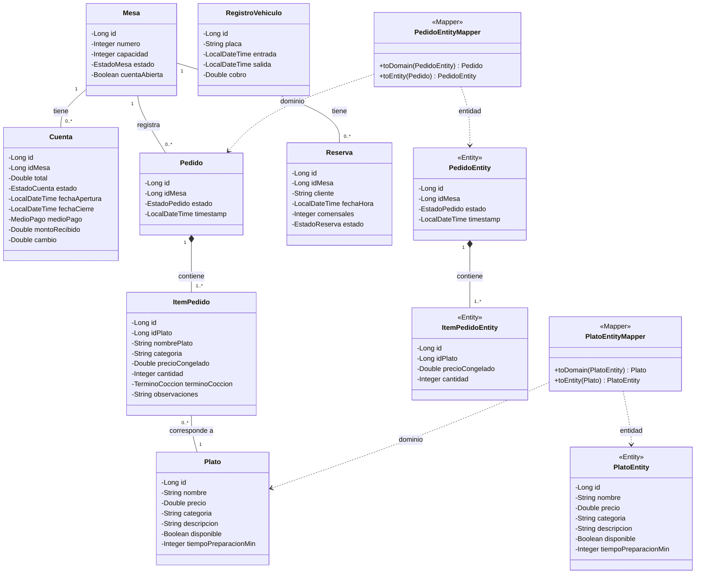

> El diagrama muestra el patrón con Plato y Pedido; Mesa, Cuenta, Reserva y RegistroVehiculo
> siguen el mismo esquema (`XEntity` + `XEntityMapper` en `persistence/`).

**Capas de persistencia**

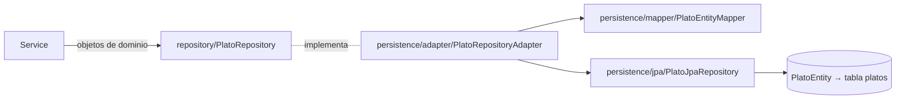

### Estados del pedido

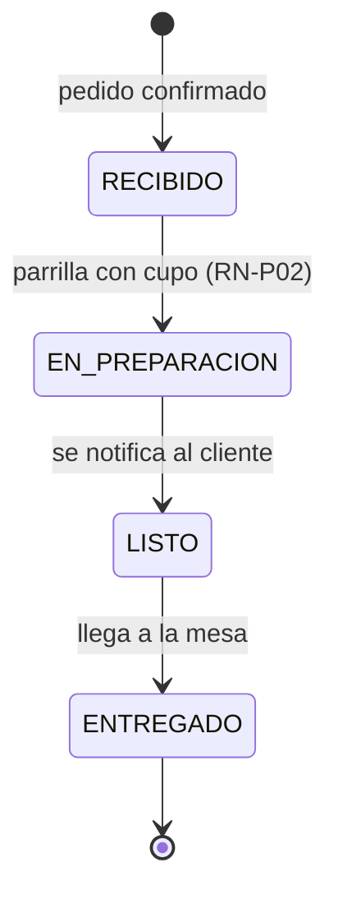

---

## Estructura del proyecto

```
src/main/java/edu/escuelaing/dosw/brasaviva
├── BrasaVivaApplication.java
├── model/domain/ modelo de dominio (lógica de negocio, sin anotaciones JPA) y enums
├── repository/   contratos de acceso a datos que usan los servicios (trabajan con dominio)
├── persistence/  infraestructura: entity/ (tablas JPA), jpa/ (Spring Data),
│                 mapper/ (dominio ↔ entidad) y adapter/ (implementan repository/)
├── service/      lógica de negocio (identidad, carta, pedidos, cocina, inventario, pagos, reportes)
├── controller/   endpoints REST
├── dto/          objetos de entrada y salida
├── client/       integraciones externas (pasarela, facturación DIAN, notificaciones)
├── security/     JWT, filtro de autenticación, handlers 401/403 y permisos por rol
├── exception/    excepciones de las reglas de negocio
└── config/       configuración
```

## Tecnologías

Java 21 · Maven · Spring Boot 3.3.4 · Spring Data JPA · PostgreSQL · MapStruct · Lombok ·
Spring Security · JWT (jjwt) · OAuth2 (Google) · springdoc-openapi (Swagger) · JUnit 5 · Mockito · JaCoCo · H2 (pruebas)

## Ejecución

```bash
docker compose up -d      # levanta PostgreSQL
mvn clean install
mvn spring-boot:run
```

La conexión se configura con las variables de entorno `DB_URL`, `DB_USER` y `DB_PASSWORD`
(por defecto `jdbc:postgresql://localhost:5432/brasaviva`, usuario `brasaviva`).

---

## Persistencia

**Tipo elegido: relacional (PostgreSQL + Spring Data JPA).**

| Opción | Evaluación para La Brasa Viva |
|---|---|
| Relacional | Los datos están fuertemente relacionados: Mesa → Cuenta → Pedido → ItemPedido → Plato. Pagar una cuenta, cancelar un pedido o confirmarlo con varios ítems debe ser atómico (transacciones ACID). Los reportes (ingresos por categoría, platos más vendidos) se resuelven con consultas SQL. |
| No relacional | Ofrece un esquema flexible, pero el esquema del restaurante es estable y las relaciones entre entidades son el núcleo del negocio. Sin joins ni transacciones entre documentos sería más difícil garantizar RN-03 (una sola cuenta abierta por mesa) y RN-04 (precio congelado). |
| Híbrida | Solo se justificaría con datos sin estructura fija (logs, catálogos con atributos variables) o con una carga de lectura muy alta. En el MVP agrega complejidad operativa sin beneficio. |

**Decisión:** relacional. Si el sistema crece (por ejemplo, un tablero de cocina en tiempo real
con mucho tráfico), se podría añadir una caché o un almacén NoSQL para esa parte y pasar a un
modelo híbrido.

### Dominio y entidad separados

La entidad representa la tabla; el dominio representa el negocio. Por eso viven en clases
distintas y un mapper traduce entre ambas:

| Capa | Paquete | Qué contiene |
|---|---|---|
| Dominio | `model/domain/Plato.java` | Reglas y comportamiento (`esValido()`, `cambiarDisponibilidad()`…). Sin anotaciones JPA |
| Entidad | `persistence/entity/PlatoEntity.java` | Solo `@Entity`, `@Table`, `@Id`, `@Column`. Sin lógica |
| Mapper | `persistence/mapper/PlatoEntityMapper.java` | MapStruct: `toDomain` / `toEntity` |
| Repositorio JPA | `persistence/jpa/PlatoJpaRepository.java` | `JpaRepository<PlatoEntity, Long>` |
| Adaptador | `persistence/adapter/PlatoRepositoryAdapter.java` | Implementa `repository/PlatoRepository` usando el repositorio JPA y el mapper |

Los servicios solo conocen `repository/PlatoRepository` y objetos de dominio; nunca ven una
entidad. Cambiar el esquema de la base de datos no toca el dominio. Los enums (`EstadoPedido`,
`EstadoMesa`…) son valores del negocio y los comparten ambas capas.

Las entidades se persisten con JPA (`ddl-auto=update`). Las pruebas unitarias de los servicios
usan repositorios en memoria (`Fake...Repository`) para no depender de la base de datos, y los
adaptadores se prueban contra H2 (`RepositoryAdapterTest`).

---

## Funcionalidades

La API agrupa sus endpoints por área funcional del restaurante. Cada grupo corresponde a un
`@Tag` de Swagger y a un controlador independiente:

### Autenticación (`/api/v1/auth`) — acceso a la API

| Método | Endpoint | Descripción |
|---|---|---|
| POST | `/api/v1/auth/login` | Iniciar sesión con email y contraseña; devuelve un JWT |
| POST | `/api/v1/auth/register` | Registrarse como cliente (siempre crea rol `CLIENTE`) |
| GET | `/api/v1/auth/me` | Ver el usuario del token actual |

### Usuarios (`/api/v1/usuarios`) — solo administrador

| Método | Endpoint | Descripción |
|---|---|---|
| GET | `/api/v1/usuarios` | Ver todos los usuarios (sin contraseñas) |
| POST | `/api/v1/usuarios` | Crear un usuario eligiendo su rol (`MESERO`, `PARRILLERO`, `ADMIN`, `CLIENTE`) |

### Menú (`/api/v1/menu`) — consulta del cliente

| Método | Endpoint | Descripción |
|---|---|---|
| GET | `/api/v1/menu` | Ver el menú (solo platos disponibles), filtro opcional por categoría |
| GET | `/api/v1/menu/{id}` | Ver el detalle de un plato del menú |

### Platos (`/api/v1/platos`) — administración de la carta

| Método | Endpoint | Descripción |
|---|---|---|
| GET | `/api/v1/platos` | Obtener todos los platos, incluye los agotados |
| GET | `/api/v1/platos/{id}` | Obtener un plato por id |
| POST | `/api/v1/platos` | Crear un plato (disponible por defecto) |
| PUT | `/api/v1/platos/{id}` | Actualizar nombre, precio, categoría, descripción y tiempo |
| PATCH | `/api/v1/platos/{id}/disponible` | Marcar disponible o agotado (RN-02) |
| DELETE | `/api/v1/platos/{id}` | Eliminar un plato de la carta |

### Mesas (`/api/v1/mesas`) — salón

| Método | Endpoint | Descripción |
|---|---|---|
| GET | `/api/v1/mesas` | Ver todas las mesas, filtro opcional por estado (DISPONIBLE, OCUPADA, RESERVADA) |
| GET | `/api/v1/mesas/{id}` | Ver una mesa |
| POST | `/api/v1/mesas` | Crear una mesa |

### Reservas (`/api/v1/reservas`)

| Método | Endpoint | Descripción |
|---|---|---|
| POST | `/api/v1/reservas` | Crear una reserva (bloqueo de 2 horas) |
| GET | `/api/v1/reservas` | Ver reservas, filtro opcional por cliente |
| GET | `/api/v1/reservas/{id}` | Ver una reserva |
| PUT | `/api/v1/reservas/{id}` | Actualizar o reprogramar una reserva |
| DELETE | `/api/v1/reservas/{id}` | Cancelar una reserva |

### Pedidos y Cocina (`/api/v1/pedidos`) — núcleo del negocio

| Método | Endpoint | Descripción |
|---|---|---|
| POST | `/api/v1/pedidos` | Confirmar un pedido, congela precios (RN-04) y exige término en cortes (RN-P01) |
| GET | `/api/v1/pedidos` | Ver todos los pedidos, filtro opcional por estado |
| GET | `/api/v1/pedidos/cocina` | Tablero de cocina: pedidos RECIBIDO y EN_PREPARACION en orden de llegada |
| GET | `/api/v1/pedidos/mesa/{idMesa}` | Ver pedidos activos de una mesa |
| GET | `/api/v1/pedidos/{id}` | Ver un pedido |
| POST | `/api/v1/pedidos/{id}/items` | Agregar un plato a un pedido (RN-01) |
| PATCH | `/api/v1/pedidos/{id}/estado` | Cambiar el estado de un pedido (RN-P02) |
| DELETE | `/api/v1/pedidos/{id}` | Cancelar un pedido (solo si sigue en RECIBIDO) |

### Cuentas y Pagos (`/api/v1/cuentas`)

| Método | Endpoint | Descripción |
|---|---|---|
| POST | `/api/v1/cuentas` | Abrir cuenta en una mesa (RN-03) |
| GET | `/api/v1/cuentas/{id}` | Ver una cuenta; si está abierta, el total se recalcula con los pedidos actuales |
| GET | `/api/v1/cuentas/mesa/{idMesa}` | Ver la cuenta abierta de una mesa |
| POST | `/api/v1/cuentas/{id}/pago` | Registrar pago y cerrar la cuenta (todos los pedidos deben estar ENTREGADOS) |

### Parqueadero (`/api/v1/parqueadero`)

| Método | Endpoint | Descripción |
|---|---|---|
| POST | `/api/v1/parqueadero/entrada` | Registrar entrada de un vehículo |
| POST | `/api/v1/parqueadero/salida/{placa}` | Registrar salida y calcular el cobro por hora o fracción |
| GET | `/api/v1/parqueadero/activos` | Ver vehículos activos |
| GET | `/api/v1/parqueadero/disponibilidad` | Ver cupos disponibles |

### Reportes (`/api/v1/reportes`) — inteligencia del negocio

| Método | Endpoint | Descripción |
|---|---|---|
| GET | `/api/v1/reportes/resumen` | Resumen del día: total de pedidos, ingresos, platos más pedidos y mesas con cuenta abierta |
| GET | `/api/v1/reportes/platos-populares` | Platos más vendidos |
| GET | `/api/v1/reportes/ingresos` | Ingresos por categoría en un rango de fechas (`yyyy-MM-dd`) |

---

## Evidencia de Swagger

La API está documentada con **springdoc-openapi / Swagger UI**, disponible en
`/swagger-ui/index.html` una vez la aplicación está corriendo. Cada endpoint incluye resumen,
descripción de la regla de negocio asociada y los códigos de respuesta esperados.

**Vista general de los grupos de endpoints (Tags)**

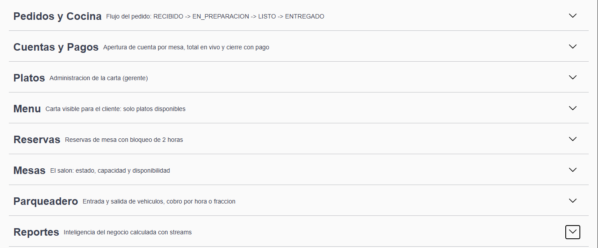

**Grupo Platos**

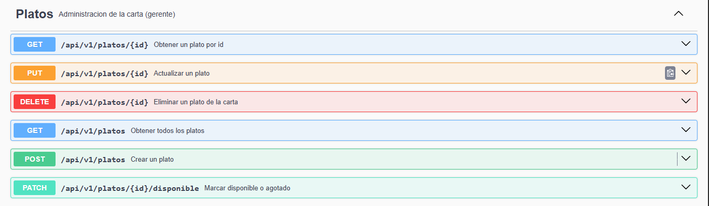

**Grupo Pedidos**

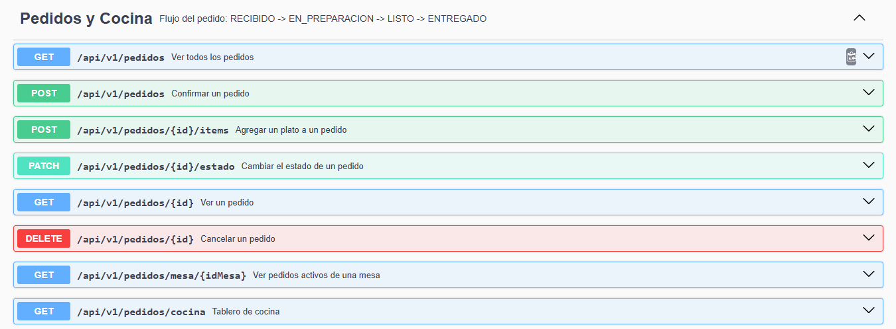

**Ejemplo de respuesta exitosa (201 Created)**

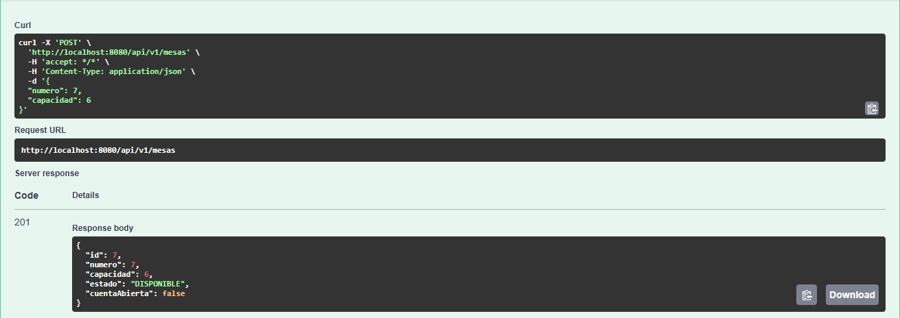

**Ejemplo de manejo de errores y validaciones (422 Unprocessable Entity)**

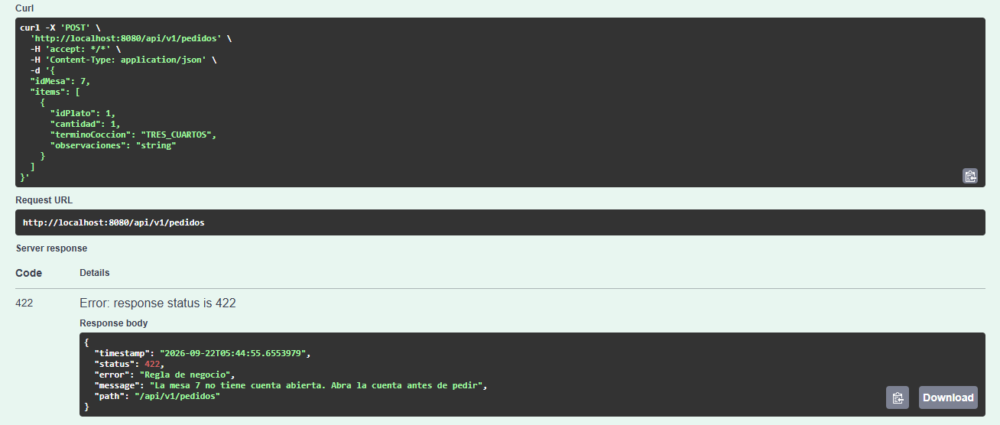

---

## Seguridad

La API usa **Spring Security con JWT** (autenticación *stateless*): el cliente inicia sesión una vez,
recibe un token firmado y lo envía en cada petición. Cada endpoint exige el rol que le corresponde
según la matriz de roles definida en el análisis (ver [Roles y permisos](#roles-y-permisos)).

| Mecanismo | Estado | Dónde |
|---|---|---|
| Roles y autorización por endpoint | Implementado | `config/SecurityConfig`, `@PreAuthorize` |
| Contraseñas con BCrypt | Implementado | `config/SecurityBeansConfig`, `UsuarioServiceImpl` |
| JWT (login, filtro, expiración 1 h) | Implementado | `security/JwtUtil`, `security/JwtAuthFilter`, `AuthController` |
| HTTP Basic | Reemplazado por JWT (ver nota) | — |
| OAuth2 "Ingresar con Google" | Implementado, activo con el perfil `oauth2` | `security/OAuth2SuccessHandler` |
| HTTPS (SSL/TLS) | Implementado, activo con el perfil `ssl` | `application-ssl.properties` |
| CORS | Implementado | `config/CorsConfig` |
| Headers de seguridad (CSP, X-Frame-Options, X-Content-Type-Options, X-XSS-Protection) | Implementado | `config/SecurityConfig` |
| Límite de intentos de login (5 fallos / 15 min → 429) | Implementado | `security/LoginAttemptService` |
| CSRF | Deshabilitado a propósito (API stateless con JWT en header) | `config/SecurityConfig` |

> **Nota sobre HTTP Basic.** La guía lo presenta como primer paso para entender el flujo de autenticación
> y luego lo reemplaza por JWT. La versión final de la API usa únicamente JWT (y opcionalmente OAuth2),
> porque Basic reenvía la contraseña en cada petición.

### Flujo de autenticación con JWT

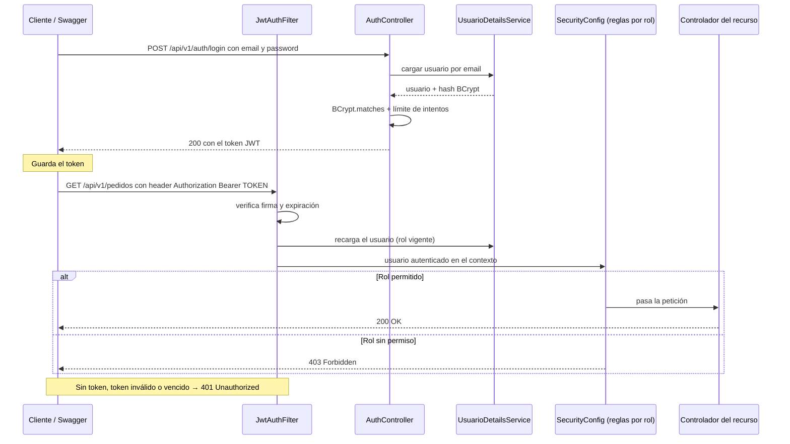

### Roles y permisos por endpoint

Cada fila corresponde a una regla de `SecurityConfig`. Los roles son `CLIENTE`, `MESERO`,
`PARRILLERO` (cocina) y `ADMIN`, los mismos de la matriz de roles del análisis.

| Endpoint | Método | ¿Quién puede? | Regla en Spring |
|---|---|---|---|
| `/api/v1/auth/login`, `/api/v1/auth/register` | POST | Público | `permitAll()` |
| `/api/v1/auth/me` | GET | Cualquier usuario autenticado | `authenticated()` |
| `/api/v1/menu`, `/api/v1/menu/{id}` | GET | Público | `permitAll()` |
| `/api/v1/platos`, `/api/v1/platos/{id}` | GET | Mesero, parrillero, admin | `hasAnyRole("MESERO","PARRILLERO","ADMIN")` |
| `/api/v1/platos` | POST | Admin | `hasRole("ADMIN")` |
| `/api/v1/platos/{id}` | PUT, DELETE | Admin | `hasRole("ADMIN")` |
| `/api/v1/platos/{id}/disponible` | PATCH | Parrillero, admin | `hasAnyRole("PARRILLERO","ADMIN")` |
| `/api/v1/pedidos` | POST | Cliente, mesero | `hasAnyRole("CLIENTE","MESERO")` |
| `/api/v1/pedidos/{id}/items` | POST | Cliente, mesero | `hasAnyRole("CLIENTE","MESERO")` |
| `/api/v1/pedidos`, `/pedidos/cocina`, `/pedidos/mesa/{idMesa}` | GET | Mesero, parrillero, admin | `hasAnyRole("MESERO","PARRILLERO","ADMIN")` |
| `/api/v1/pedidos/{id}` | GET | Todos los roles autenticados | `hasAnyRole(...)` |
| `/api/v1/pedidos/{id}/estado` | PATCH | Depende del estado destino (ver abajo) | URL: `hasAnyRole("MESERO","PARRILLERO","ADMIN")` + `@PreAuthorize` |
| `/api/v1/pedidos/{id}` | DELETE | Mesero, admin | `hasAnyRole("MESERO","ADMIN")` |
| `/api/v1/mesas`, `/api/v1/mesas/{id}` | GET | Mesero, parrillero, admin | `hasAnyRole("MESERO","PARRILLERO","ADMIN")` |
| `/api/v1/mesas` | POST | Admin | `hasRole("ADMIN")` |
| `/api/v1/cuentas`, `/api/v1/cuentas/{id}/pago` | POST | Mesero | `hasRole("MESERO")` |
| `/api/v1/cuentas/{id}`, `/cuentas/mesa/{idMesa}` | GET | Mesero, admin | `hasAnyRole("MESERO","ADMIN")` |
| `/api/v1/reservas/**` | todos | Cliente, mesero, admin | `hasAnyRole("CLIENTE","MESERO","ADMIN")` |
| `/api/v1/parqueadero/**` | todos | Mesero, admin | `hasAnyRole("MESERO","ADMIN")` |
| `/api/v1/reportes/**` | GET | Admin | `hasRole("ADMIN")` |
| `/api/v1/usuarios/**` | GET, POST | Admin | `hasRole("ADMIN")` + `@PreAuthorize` en el controlador |
| `/swagger-ui/**`, `/v3/api-docs/**` | GET | Público (apagable en producción) | `permitAll()` |
| Cualquier otro endpoint | — | Usuario autenticado | `authenticated()` |

**Cambio de estado de un pedido** (`PATCH /api/v1/pedidos/{id}/estado`): la URL es la misma para
todos, así que además se valida el estado destino con `@PreAuthorize` (`security/PermisosPedido`):

| Estado destino | Rol permitido |
|---|---|
| `EN_PREPARACION`, `LISTO` | Parrillero |
| `ENTREGADO` | Mesero |
| `CANCELADO` | Mesero, admin |

### Usuarios de ejemplo

Al arrancar con la base vacía se crea un usuario por rol (`UsuarioInitializer`). La contraseña de
desarrollo es `Brasa2026` (configurable con `SEED_PASSWORD`).

| Rol | Email |
|---|---|
| ADMIN | `admin@brasaviva.com` |
| MESERO | `mesero@brasaviva.com` |
| PARRILLERO | `parrillero@brasaviva.com` |
| CLIENTE | `cliente@brasaviva.com` |

> Son credenciales **solo para desarrollo**. En producción se desactivan con `SEED_USUARIOS=false`.

### Cómo probar

```bash
# 1. Iniciar sesión y guardar el token
TOKEN=$(curl -s -X POST http://localhost:8080/api/v1/auth/login \
  -H "Content-Type: application/json" \
  -d '{"email":"admin@brasaviva.com","password":"Brasa2026"}' | jq -r .token)

# 2. Llamar un endpoint protegido
curl -i http://localhost:8080/api/v1/reportes/resumen -H "Authorization: Bearer $TOKEN"   # 200

# 3. Sin token -> 401
curl -i http://localhost:8080/api/v1/reportes/resumen

# 4. Con el rol incorrecto -> 403 (el cliente no puede ver reportes)
```

En Swagger UI (`/swagger-ui/index.html`): ejecutar `POST /api/v1/auth/login`, copiar el campo `token`,
pulsar **Authorize** e ingresarlo.

### Variables de configuración

| Variable | Para qué sirve | Valor por defecto (solo desarrollo) |
|---|---|---|
| `JWT_SECRET` | Secreto de firma del JWT, en Base64 y de al menos 256 bits | Valor de desarrollo en `application.properties` |
| `JWT_EXPIRATION_MS` | Vigencia del token | `3600000` (1 hora) |
| `CORS_ORIGENES` | Orígenes (frontends) permitidos, separados por coma | `http://localhost:3000` |
| `SEED_USUARIOS` | Crear usuarios de ejemplo al arrancar | `true` |
| `SEED_PASSWORD` | Contraseña de los usuarios de ejemplo | `Brasa2026` |
| `SWAGGER_ENABLED` | Mostrar Swagger UI y `/v3/api-docs` | `true` |
| `GOOGLE_CLIENT_ID`, `GOOGLE_CLIENT_SECRET` | Credenciales OAuth2 (perfil `oauth2`) | — |
| `SSL_KEYSTORE_PASSWORD` | Clave del certificado (perfil `ssl`) | — |

> **En producción** hay que definir `JWT_SECRET` (el valor por defecto está en el repositorio y por
> tanto no es secreto), `SEED_USUARIOS=false` y `SWAGGER_ENABLED=false`.

### HTTPS (SSL/TLS)

```bash
export SSL_KEYSTORE_PASSWORD='<una-clave>'
./scripts/generar-certificado.sh            # crea src/main/resources/restaurante.p12 (ignorado por Git)
mvn spring-boot:run -Dspring-boot.run.profiles=ssl
# https://localhost:8443/swagger-ui/index.html  (el navegador avisará: el certificado es autofirmado)
```

El certificado y su clave no se suben a Git (`*.p12` está en `.gitignore`). En producción se usa un
certificado real (Let's Encrypt o el de Azure) inyectado como secreto.

### Login con Google (OAuth2)

1. En [Google Cloud Console](https://console.cloud.google.com) → *APIs y servicios* → *Credenciales* →
   crear un *ID de cliente OAuth* de tipo *Aplicación web*.
2. Agregar como URI de redirección autorizada: `http://localhost:8080/login/oauth2/code/google`.
3. Arrancar con el perfil `oauth2`:

```bash
GOOGLE_CLIENT_ID=... GOOGLE_CLIENT_SECRET=... mvn spring-boot:run -Dspring-boot.run.profiles=oauth2
```

4. Abrir `http://localhost:8080/oauth2/authorization/google`. Tras autenticarse con Google, la API crea
   el usuario como `CLIENTE` (si no existía) y devuelve un JWT propio del sistema.

### Evidencias de seguridad

**Login exitoso en Swagger (request y respuesta con el JWT)**

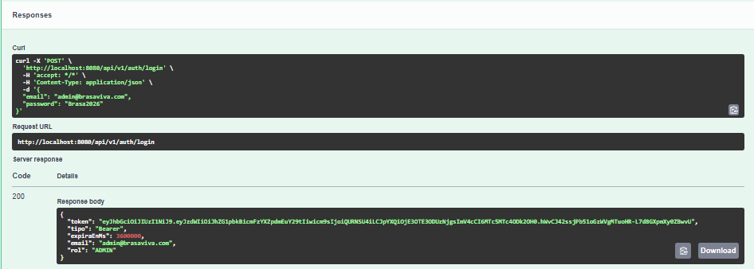

**Botón Authorize con el token ingresado**

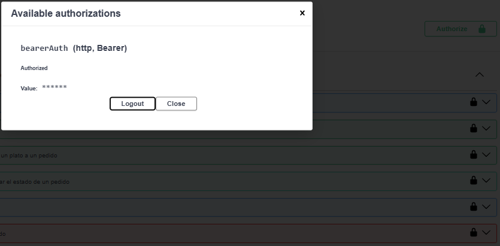

**401 al llamar sin token**

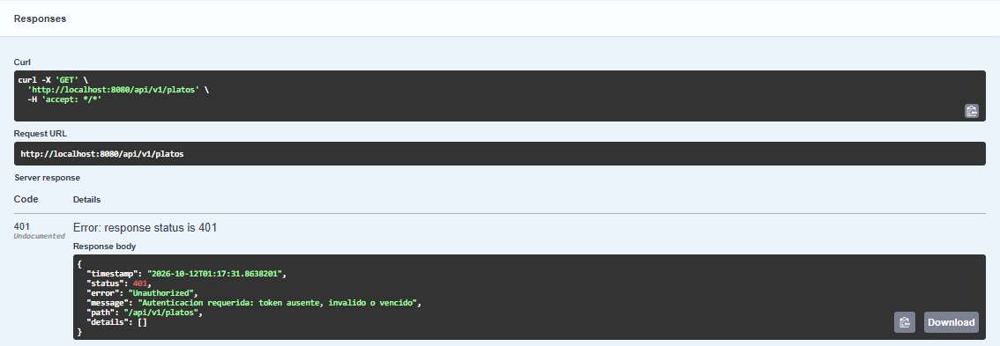

**403 al llamar con un rol incorrecto**

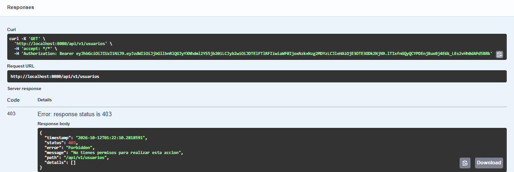

**Headers de seguridad en las respuestas**

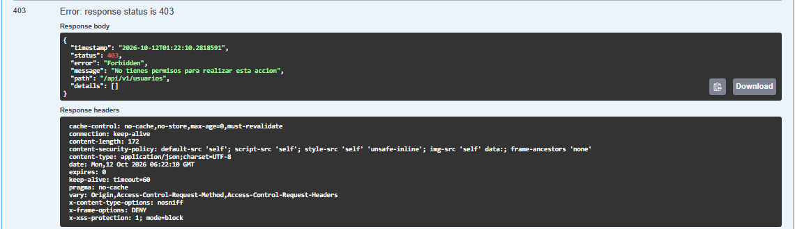

**Contraseñas hasheadas en la base de datos**

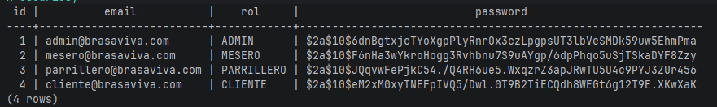

**Pruebas de seguridad en verde (`mvn test`)**

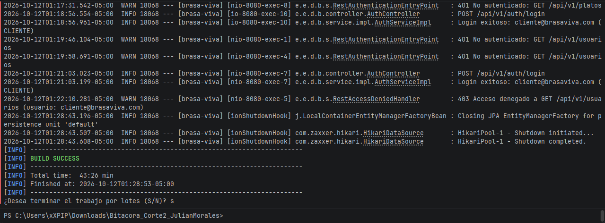

Las pruebas viven en `src/test/java/.../security/` y `service/` (`SecurityTest`, `JwtUtilTest`,
`LoginAttemptServiceTest`, `PermisosPedidoTest`, `UsuarioServiceTest`, `AuthServiceTest`).
`SecurityTest` levanta el contexto completo con H2 y verifica: login correcto e incorrecto, 429 por
fuerza bruta, 401 sin token / con token inválido / vencido / con firma falsa, 403 por rol, 201 con el
rol correcto, cambio de estado según rol, registro, contraseña hasheada, headers de seguridad y CORS.

### Checklist OWASP Top 10

| # | Riesgo | ¿Aplica? | Cómo se mitiga | Pendiente / límite |
|---|---|---|---|---|
| A01 | Control de acceso roto | Sí | Reglas por rol en `SecurityConfig` + `@PreAuthorize`; el registro público nunca crea roles altos; pruebas de 403 por rol | No hay control de **propiedad del objeto**: un `CLIENTE` autenticado puede consultar `GET /pedidos/{id}` de otro cliente (los pedidos se asocian a una mesa, no a un usuario) |
| A02 | Fallas criptográficas | Sí | Contraseñas con BCrypt; JWT firmado con HMAC y secreto de ≥ 256 bits (la app no arranca con uno menor); HTTPS con el perfil `ssl` | El secreto por defecto está en el repositorio: en producción se debe sobrescribir con `JWT_SECRET`. El certificado de desarrollo es autofirmado |
| A03 | Inyección | Sí | Solo métodos derivados de Spring Data JPA; no hay `@Query` ni SQL concatenado; validación de entrada con Bean Validation | — |
| A04 | Diseño inseguro | Sí | Los `ResponseDTO` no incluyen contraseña ni hash (`UsuarioResponseDTO`); `@ToString.Exclude` en el campo password; el login no revela si el email existe | — |
| A05 | Mala configuración | Sí | `server.error.include-stacktrace=never`; el fallback de errores devuelve un mensaje genérico; secretos por variable de entorno; `*.p12` y `.env` en `.gitignore`; Swagger apagable con `SWAGGER_ENABLED=false` | Swagger queda público por defecto (útil en desarrollo); hay que apagarlo en producción |
| A06 | Componentes vulnerables | Sí | Spring Boot 3.3.4 y dependencias desde Maven Central | Pendiente ejecutar el análisis: `mvn org.owasp:dependency-check-maven:check` (la guía menciona `mvn dependency:check`, que no es un goal real de Maven) |
| A07 | Fallas de autenticación | Sí | JWT con expiración (401, no 500, cuando vence); límite de 5 intentos fallidos por email en 15 min (429); política de contraseña (8–72 caracteres con mayúscula, minúscula y número) | El límite es en memoria (una sola instancia) y por email, no por IP. No hay *refresh token* ni cierre de sesión que invalide el token antes de que venza |
| A08 | Integridad de software y datos | Sí | La firma del JWT se verifica en cada petición; dependencias de Maven Central | — |
| A09 | Logging y monitoreo | Sí | Se registran los logins fallidos y bloqueados, los 401, los 403 y los tokens inválidos o vencidos (sin escribir contraseñas ni tokens) | Los logs van a consola; no hay alertas ni monitoreo centralizado |
| A10 | SSRF | No | Ningún endpoint recibe URLs como entrada | — |

---

## Cobertura de pruebas y análisis estático

### Pruebas — TDD (ciclo rojo/verde)

El desarrollo de los servicios siguió el ciclo TDD: primero la prueba que falla, luego la
implementación mínima para pasarla.

**Prueba en rojo (falla antes de implementar)**

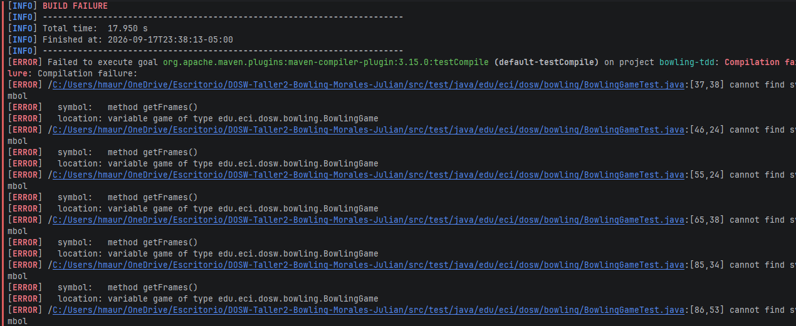

**Prueba en verde (pasa tras implementar)**

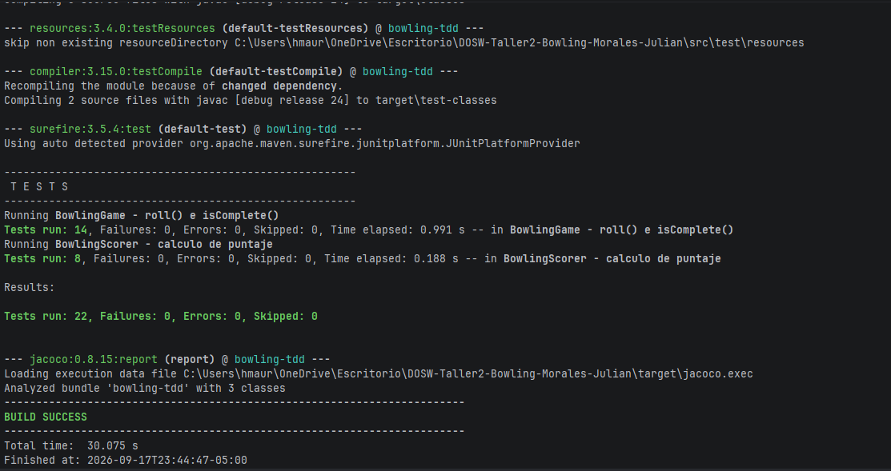

### Cobertura — JaCoCo

**Cobertura antes de completar las pruebas**

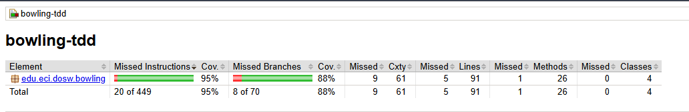

**Cobertura final del proyecto**

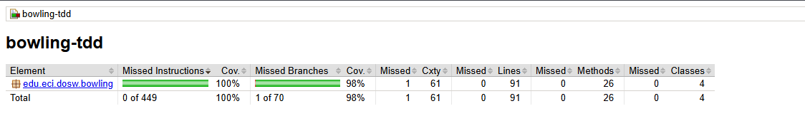

**Reporte detallado de cobertura por paquete**

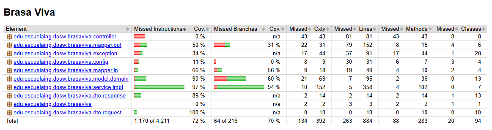

### Análisis estático — SonarQube

El análisis se ejecutó localmente con SonarQube Community (Docker) y el plugin de Maven:

```bash
docker compose up -d sonarqube
mvn org.sonarsource.scanner.maven:sonar-maven-plugin:5.8.0.7211:sonar -Dsonar.token=<TOKEN>
```

**Quality Gate**

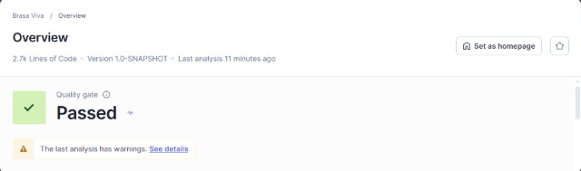

**Métricas del proyecto**: 0 problemas de seguridad, cobertura de 97.7 % y 0.0 % de duplicación.

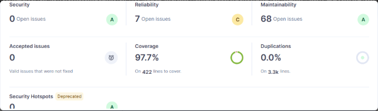
---

## Evidencia de ejecución y pruebas por funcionalidad

| Funcionalidad | Clase de servicio | Clase(s) de prueba |
|---|---|---|
| Carta y administración de platos | `PlatoService` | `PlatoServiceTest`, `PlatoMapperTest` |
| Mesas y salón | `MesaService` | `MesaServiceTest` |
| Reservas | `ReservaService` | `ReservaServiceTest` |
| Pedidos y cocina | `PedidoService` | `PedidoServiceTest`, `PedidoMapperTest` |
| Cuentas y pagos | `CuentaService` | `CuentaServiceTest` |
| Parqueadero | `ParqueaderoService` | `ParqueaderoServiceTest` |
| Reportes | `ReporteService` | `ReporteServiceTest` |
| Modelo de dominio (entidades y enums) | `model` | `ModeloDominioTest` |

Todas las pruebas se ejecutan con:

```bash
mvn test
```

Los reportes de JaCoCo se generan en `target/site/jacoco/index.html` tras correr:

```bash
mvn clean verify
```
